# FEDER por correo — INF513 Proyecto 1 (Grupo 28)

Sistema backend con **arquitectura dirigida por correo (Email-Driven)** para FEDER: un canal de venta en línea de productos agrícolas con seguimiento desde el registro de la producción hasta la entrega al cliente. El usuario manda un comando en el **Asunto** de un correo a `grupo28sa@tecnoweb.org.bo` y el sistema le responde automáticamente con el resultado.

```
Asunto:  INSCAR["1","10"]        →   Respuesta:  "Agregado: 10 kg de Arroz grano de oro ... TOTAL: Bs 95.00"
```

- **76 comandos** que cubren los casos de uso CU1–CU8 (RF01–RF17). El detalle está en [doc/COMANDOS.md](doc/COMANDOS.md); hay un guion de demostración en [doc/FLUJO_DEMO.md](doc/FLUJO_DEMO.md).
- **Roles reales** (Administrador, Personal de FEDER, Productor, Cliente): los permisos se leen de la BD (`rol_permiso`) y cada handler verifica además que el usuario sea dueño de los datos.
- Reserva de stock por lotes (primero vence, primero sale), **sin sobreventa** ante compras simultáneas (`SELECT ... FOR UPDATE`).
- **Respuestas en HTML con diseño** (tablas reales, insignia ÉXITO/ERROR) más una versión en texto plano para clientes que no muestran HTML.
- **Pago por QR sin pasarela:** el Administrador sube el QR de cobro (`SUBQR` con la imagen adjunta), el cliente lo recibe al pagar y el Personal verifica el depósito a mano (`MODPAG`).
- Notificaciones por correo al cliente, alertas de inventario al personal y logs de auditoría `access.log` / `error.log` con el **origen de cada error** (`[BD]`, `[POP3]`, `[SMTP]`, `[COMANDO]`…).

---

## 1. Arquitectura

```
[Cliente / remitente]
      │  correo con el comando en el Asunto
      ▼
[Servidor de correo tecnoweb.org.bo]  (casilla grupo28sa, POP3 :110)
      │  FederCorreo lee la casilla cada 5 s (proceso vigilado por cron)
      │  y extrae el Asunto (MIME UTF-8) y las imágenes adjuntas (p. ej. el QR de SUBQR)
      ▼
[ParserAsunto] ──(sintaxis inválida)──────────────► correo de ERROR con la posición del fallo
      │
[Registro de comandos] ──(no existe)──────────────► ERROR + sugerencia ("¿Quiso decir LISPRO?")
      │
[Autorización] remitente → usuario → rol → rol_permiso ──(sin permiso)──► ERROR "No autorizado"
      │
[Validador de tipos] entero, decimal, fecha, email, CI, opción... ──(inválido)──► ERROR + uso + ejemplo
      │
[Handler de negocio] → PostgreSQL (PreparedStatement, transacciones, funciones plpgsql)
      ├── error de negocio / SQL ─────────────────► ERROR detallado
      ├── BD caída ───────────────────────────────► el correo NO se borra: se reintenta
      └── éxito ──────────────────────────────────► correo de ÉXITO con los datos (+ notificaciones)
      │
[EnviadorCorreo] SMTP :25, multipart (texto + HTML, imagen incrustada si hay QR)
      └── falla el SMTP ──► el comando YA se ejecutó: el correo se borra igual (no se repite) y se registra [SMTP]
```

Cada iteración del ciclo se muestra en consola, por ejemplo:

```
2026-11-19 20:37:55 [Ciclo #2] BD OK | POP3 OK | bandeja 0 | 7533 ms
2026-11-19 20:38:09 [Ciclo #3] BD OK | POP3 OK | bandeja 1 -> 1 respondidos | 8517 ms
2026-11-19 20:36:00   [ERROR][POP3] No se pudo leer la bandeja mail.tecnoweb.org.bo:110 -> usuario/clave rechazados
```

### Paquetes (`src/main/java/feder`)

| Paquete | Responsabilidad |
|---|---|
| `app` | `Main` (ciclo y modo TEST), `CorreoService` (POP3/SMTP), `ProcesadorComandos` (orquesta el flujo), `Mantenimiento` (tareas periódicas), `Herramientas` (diagnóstico, carga de SQL, manual) |
| `infra` | `Config` (config.properties), `ConexionDB`, `ConexionCorreo`, `EnviadorCorreo` (SMTP: texto + HTML, imagen incrustada), `PlantillaHtml` (diseño de los correos), `Adjuntos` (imágenes recibidas), `Notificador`, `Log` (access/error con origen del error) |
| `parser` | `ParserAsunto` (analizador léxico), `ParamSpec`/`Params` (tipos y validación), `ComandoSpec`/`Registro` (catálogo de comandos) |
| `seguridad` | `Contexto` (quién escribe), `Autorizacion` (rol + permisos desde la BD) |
| `negocio` | Clases comunes: `Respuesta`, `TablaFormato`, `Db` (consultas preparadas y transacciones), `Fila`, `ErrorNegocio`, `Edicion` |
| `negocio.administracion` | CU1 usuarios, roles y permisos (`usuarios`) · CU7 indicadores financieros (`finanzas`) · CU8 reportes (`reportes`) |
| `negocio.operacion` | CU2 productores y comunidades (`productores`) · CU3 producción, lotes y trazabilidad (`produccion`) · CU4 catálogo, inventario y alertas (`inventario`) |
| `negocio.comercial` | CU5 carrito, compras y encargos (`comercio`) · CU6 pedidos, pagos y QR, entregas y notificaciones (`pedidos`) |

Dependencias entre los paquetes de negocio (sin ciclos): `comercial → operacion` (los pedidos reservan y descuentan stock de los lotes) y `administracion → comercial / operacion` (reportes e indicadores leen ventas y producción).

Cada comando se declara **una sola vez** (nombre, módulo, acción, tipos de parámetros, descripción, ejemplo, handler). De esa declaración salen la validación, la autorización, el `HELP` según el rol y el manual `doc/COMANDOS.md`.

## 2. Diagrama de flujo del analizador de correos

```mermaid
flowchart TD
    A[Ciclo cada 5 s] --> B{¿BD disponible?}
    B -- no: registrar BD --> A
    B -- sí --> C[POP3: leer INBOX, ordenar del más antiguo al más nuevo]
    C --> D{¿Quedan mensajes?}
    D -- no --> M[Mantenimiento: reservas vencidas, lotes vencidos, alertas] --> A
    D -- sí --> E{¿Remitente automático o propio?}
    E -- sí --> X[Borrar sin responder] --> D
    E -- no --> F[Decodificar asunto MIME UTF-8, quitar RE:/FW:, leer imágenes adjuntas]
    F --> G{¿Sintaxis COMANDO&#91;'p1',...&#93; válida?}
    G -- no --> R1[Responder ERROR de sintaxis con posición]
    G -- sí --> H{¿Comando existe?}
    H -- no --> R2[Responder ERROR + sugerencia]
    H -- sí --> I[Buscar remitente en usuario → rol]
    I --> J{¿El rol tiene permiso? rol_permiso}
    J -- no --> R3[Responder No autorizado / solo HELP y REGCLI]
    J -- sí --> K{¿Cantidad y tipos de parámetros válidos?}
    K -- no --> R4[Responder ERROR + uso + ejemplo]
    K -- sí --> L[Ejecutar handler en transacción]
    L --> N{Resultado}
    N -- BD caída --> Q[Conservar correo para reintentar] --> D
    N -- error --> R5[Responder ERROR detallado] --> S
    N -- éxito --> R6[Responder ÉXITO + enviar notificaciones] --> S
    R1 --> S
    R2 --> S
    R3 --> S
    R4 --> S
    S{¿SMTP envió la respuesta?}
    S -- sí --> Z
    S -- no --> W[Registrar SMTP en error.log] --> Z
    Z[Borrar correo, registrar en access.log] --> D
```



## 3. Base de datos

PostgreSQL `db_grupo28sa`. El script es [db/schema.sql](db/schema.sql), el modelo FEDER v4: 23 tablas, 3 vistas y 7 funciones plpgsql.
Para una BD ya creada antes del pago por QR, basta aplicar [db/migracion_qr.sql](db/migracion_qr.sql) (se puede ejecutar varias veces).

| Área | Tablas |
|---|---|
| CU1 Usuarios | `rol`, `permiso`, `rol_permiso` (ver/crear/editar/eliminar por módulo), `usuario` |
| CU2 Productores | `comunidad`, `emprendimiento`, `emprendimiento_producto` (ofertas) |
| CU3/CU4 Producción e inventario | `categoria`, `producto`, `produccion`, `lote`, `movimiento_inventario`, `alerta_inventario` |
| CU5 Encargos | `encargo`, `detalle_encargo` |
| CU6 Pedidos | `pedido`, `detalle_pedido`, `reserva_lote`, `metodo_pago`, `pago`, `qr_pago` (QR de cobro subido por el Administrador, con historial), `entrega`, `notificacion` |

- **Vistas:** `v_disponibilidad_producto` (stock propio / reservado / producción reportada / futura), `v_saldo_pedido` (cobrado y saldo), `v_trazabilidad` (producto vendido → lote → emprendimiento → comunidad).
- **Funciones:** `fn_ingresar_lote`, `fn_reservar_pedido` / `fn_reservar_detalle` (reserva por lotes, primero vence primero sale, con `FOR UPDATE`), `fn_confirmar_reservas` (salida de inventario), `fn_liberar_reservas`, `fn_liberar_reservas_vencidas`, `fn_revisar_stock_minimo`.
- **Carrito sin tabla extra:** es el `pedido` del cliente en estado `pendiente` que todavía no tiene `entrega`. `CONCAR` reserva el stock y crea la entrega, y desde ahí es un pedido real.
- **Estados del pedido:** pendiente → confirmado (al completar el pago) → en_preparacion (descuenta los lotes) → listo_entrega (se avisa al cliente) → entregado. Se puede cancelar desde pendiente o confirmado, y eso libera el stock.
- Las contraseñas se guardan con **BCrypt** (`$2a$`), compatible con Laravel para el parcial 2.

## 4. Seguridad

- **Consultas preparadas** en todo el acceso a datos (`feder.negocio.Db`). En los comandos `MODxxx["id","campo","valor"]` el nombre de la columna sale de una lista blanca del código, nunca del texto del usuario.
- **Validación estricta en el servidor** antes de llegar a SQL: cantidad de parámetros, enteros positivos, decimales con 2 decimales como máximo, fechas, correos, CI, teléfonos, opciones cerradas y largo máximo.
- **Autorización por rol desde la BD** y control de propiedad: el Cliente solo ve sus pedidos, pagos y encargos, y el Productor solo su emprendimiento, producción y lotes.
- Las contraseñas se enmascaran (`****`) en los logs y en el asunto de la respuesta.
- Nota: la identidad es el correo remitente, que se puede falsificar. Alcanza para el alcance académico, pero no es autenticación fuerte.

## 5. Instalación y uso

Requisitos: **Java 21** y Maven 3.9 (solo para compilar).

```bash
mvn package                      # genera target/FederCorreo-1.0.jar (incluye dependencias)
```

La configuración está en `config.properties` (copiar de `config.properties.example`). Si no existe, se usan las credenciales del grupo 28.

### 5.1 Probar SIN correo, desde cualquier PC (modo TEST)

No necesita que el docente habilite la IP: ejecuta el comando como si llegara de ese remitente, contra la BD real.

```bash
probar.bat cliente.ana@example.com "LISPRO[\"*\"]"           # Windows
./probar.sh cliente.ana@example.com 'LISPRO["*"]'            # Linux / Git Bash
probar.bat -f doc\pruebas.txt                               # guion completo (~90 comandos, todos los roles)
```

Usuarios de prueba (todos con clave `feder123`):

| Correo | Rol |
|---|---|
| feder.admin@example.com | Administrador |
| feder.personal@example.com | Personal |
| productor.pedro@example.com | Productor (Arrocera Los Angeles) |
| productor.rosa@example.com | Productor (Apícola Flor del Monte) |
| cliente.ana@example.com / cliente.carlos@example.com | Cliente |
| cualquier otro correo | No registrado (solo `HELP` y `REGCLI`) |

Para dejar la BD como al principio: `herramientas.bat sql db\schema.sql` y luego `herramientas.bat sql db\datos_prueba.sql`.

Otras utilidades (`herramientas.bat <opción>`):

| Opción | Qué hace |
|---|---|
| `diag` | Prueba el login a la BD y a POP3 |
| `query "SELECT ..."` | Ejecuta una consulta y muestra la tabla |
| `sql archivo.sql` | Ejecuta un script completo en una transacción |
| `manual` | Regenera doc/COMANDOS.md desde el registro de comandos |
| `preview correo "ASUNTO"` | Guarda en `logs/preview.html` cómo se vería la respuesta (ejecuta el comando de verdad) |
| `subirqr imagen.png [correo_admin]` | Carga el QR de cobro desde un archivo, igual que `SUBQR` |

### 5.2 Probar con correo real desde una PC (modo DEV)

```bash
run_dev.bat          # o ./run_dev.sh
```

Equivale a `java -DMODE=DEV -jar target\FederCorreo-1.0.jar`. Lee la casilla por POP3 y responde por SMTP, y muestra una línea por ciclo (`consola.ciclos=false` en config.properties para mostrar solo cuando llegan correos). **No lo corran a la vez que el servidor:** los dos leerían la misma casilla y se repartirían los correos. El servidor SMTP de tecnoweb **solo acepta enviar desde IPs habilitadas por el docente**. Si la respuesta falla con `Relaying denied`, hay que pedir que habiliten la IP pública de esa PC. Para probar con su propio correo, cambien el email de un usuario de prueba (`MODUSU["id","email","su@correo.com"]` desde el admin en modo TEST) o regístrense con `REGCLI`.

### 5.3 Producción en el servidor (modo SERVER)

```bash
scp target/FederCorreo-1.0.jar run.sh setup_cron.sh grupo28sa@www.tecnoweb.org.bo:~
ssh grupo28sa@www.tecnoweb.org.bo
bash setup_cron.sh        # una sola vez: el cron levanta FederCorreo y lo revisa cada 5 min
tail -f feder.log logs/access.log
```

En SERVER todo va por `localhost` (BD y correo), así que no depende de ninguna IP.

## 6. Logs

| Archivo | Contenido |
|---|---|
| `logs/access.log` | `fecha \| remitente \| rol \| EXITO/ERROR \| comando \| duración \| resumen`, un registro por correo. Si la respuesta no se pudo enviar, el resumen termina en `[respuesta NO enviada: SMTP]` |
| `logs/error.log` | Excepciones con traza completa, etiquetadas por origen |
| `feder.log` (servidor) | Salida de consola del proceso (incluye la línea de cada ciclo) |

Etiquetas de error, para saber de un vistazo qué falló:

| Etiqueta | Origen | Ejemplo de causa |
|---|---|---|
| `[BD]` | PostgreSQL | clave incorrecta, servidor caído, conexión cortada |
| `[POP3]` | Lectura de la casilla | usuario/clave rechazados, tiempo de espera agotado |
| `[SMTP]` | Envío de respuestas y avisos | puerto cerrado, IP no habilitada para enviar |
| `[COMANDO]` | Error SQL o interno al ejecutar un comando | restricción violada, error inesperado |
| `[MANTENIMIENTO]` | Tareas periódicas | liberación de reservas, alertas de stock |

## 7. Pago por QR (sin pasarela)

No hay credenciales de PagoFácil este semestre, así que el cobro por QR es **manual**:

1. El Administrador envía `SUBQR` con la imagen del QR de la cuenta de FEDER **adjunta** (PNG/JPG, máx. 2 MB). Queda guardado en `qr_pago`; si sube otro, reemplaza al anterior.
2. El Cliente envía `INSPAG["<pedido>","qr"]` y recibe el QR incrustado en el correo (y adjunto), con el **monto exacto** y el **número de pedido** que debe poner en la glosa. El pago queda `pendiente`.
3. El Personal recibe el aviso *Pago QR por verificar*, revisa la cuenta y responde `MODPAG["<pago>","pagado"]` o `MODPAG["<pago>","rechazado"]`.
4. Al marcarlo pagado se notifica al cliente y, si se completó el total, el pedido pasa a `confirmado`. `VERQR` muestra el QR vigente.
